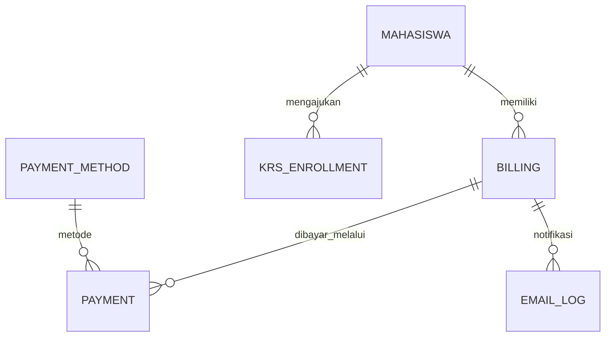

# MINGGU 11: Modul Keuangan (SPP)

Sistem manajemen pembayaran SPP dengan pengelolaan status tunggakan, *scheduled jobs* (`APScheduler`), simulasi *payment gateway webhook* (HMAC-SHA256 + email receipt), pemblokiran KRS otomatis untuk mahasiswa menunggak, dashboard keuangan *real-time*, dan **AI Financial Report** berformat JSON.

---

## Pemetaan Deliverables

| # | Deliverable | Bobot | Implementasi |
| :-: | :--- | :-: | :--- |
| 1 | **Payment Schema** | 25% | `schema.sql` & `app/models.py` (`billing`, `payment`, `payment_method`, `mahasiswa`, `krs_enrollment`, `email_log`) dengan status `unpaid`, `partial`, `paid`, `overdue`. |
| 2 | **Billing Service** | 35% | `app/services/billing_service.py` & `app/services/scheduler_service.py`: `generate_billing` (Teknik Rp 5 jt, Ekonomi Rp 4 jt, due date +14 hari), `process_payment` atomik dalam DB transaction, `calculate_late_fee` (0.5%/hari, cap 10%), cron `APScheduler`, dan **Block KRS**. |
| 3 | **Dashboard Keuangan** | 20% | `app/services/dashboard_service.py`, `app/routers/dashboard.py` (REST + SSE real-time), dan UI `app/static/` (per mahasiswa, collection rate per program studi, grafik pembayaran per bulan). |
| 4 | **Payment Webhook Simulation** | 15% | `app/services/webhook_service.py` & `app/routers/webhook.py` (`POST /api/webhook/payment`), verifikasi HMAC-SHA256, idempotency `transaction_id`, update status tagihan, dan kirim kuitansi via email (`app/services/email_service.py` → folder `receipts/` & tabel `email_log`). |
| 5 | **AI Financial Report** | 5% | `app/services/ai_report_service.py`, `app/routers/ai_report.py`, `data/payment_data.csv`, dan `scripts/run_ai_report.py` — analisis CSV (`nim, jumlah, tanggal, status`) menghasilkan output JSON untuk frontend. |

---

## Arsitektur Singkat



### Struktur Folder
```text
Materi11/
├── schema.sql                    # DDL SQL murni (Deliverable 1)
├── requirements.txt              # Daftar dependensi Python
├── pytest.ini                    # Konfigurasi pytest
├── data/
│   └── payment_data.csv          # Dataset CSV (nim,jumlah,tanggal,status) untuk AI Report
├── scripts/
│   ├── test_webhook_curl.py      # Uji webhook dengan curl + HMAC-SHA256 (cross-platform)
│   ├── test_webhook_curl.ps1     # Uji webhook dengan curl + HMAC-SHA256 (PowerShell)
│   ├── test_webhook_curl.sh      # Uji webhook dengan curl + HMAC-SHA256 (Bash)
│   └── run_ai_report.py          # Runner CLI AI Financial Insights (JSON)
├── app/
│   ├── main.py                   # Entrypoint FastAPI + Lifespan (init DB, seed, APScheduler)
│   ├── config.py                 # Tarif SPP, aturan denda, WEBHOOK_SECRET, SMTP/LLM opsional
│   ├── database.py               # SQLAlchemy engine, SessionLocal, atomic_transaction
│   ├── models.py                 # ORM models (Deliverable 1)
│   ├── schemas.py                # Pydantic schemas
│   ├── seed.py                   # Seed data awal realistis (24 mahasiswa, multi-bulan)
│   ├── services/
│   │   ├── billing_service.py    # Generate billing, payment atomik, denda, Block KRS
│   │   ├── webhook_service.py    # Verify HMAC-SHA256 signature & handle_webhook
│   │   ├── email_service.py      # Receipt email (HTML di receipts/ + SMTP opsional) & reminder
│   │   ├── scheduler_service.py  # APScheduler cron job semesteran & harian
│   │   ├── dashboard_service.py  # Agregasi metrik dashboard keuangan real-time
│   │   ├── ai_report_service.py  # Analisis CSV -> JSON insights (hybrid Pandas + LLM opsional)
│   │   └── realtime.py           # Event broker SSE real-time
│   ├── routers/                  # FastAPI endpoints (billing, webhook, krs, dashboard, ai_report)
│   └── static/                   # Web Dashboard Real-Time (HTML, CSS, JS, SVG Chart)
└── tests/                        # Automated unit & integration tests (pytest)
```

---

## Cara Menjalankan

### 1. Install Dependensi
```powershell
pip install -r requirements.txt
```

### 2. Jalankan Server FastAPI + Dashboard Real-Time
```powershell
uvicorn app.main:app --reload
```
Buka di browser:
- **Dashboard Keuangan Real-Time:** `http://127.0.0.1:8000`
- **Dokumentasi API (Swagger UI):** `http://127.0.0.1:8000/docs`

Saat pertama kali dijalankan, aplikasi otomatis:
1. Membuat tabel database SQLite (`spp_keuangan.db`) sesuai skema.
2. Mengisi data awal realistis (23 mahasiswa aktif Teknik & Ekonomi + 1 non-aktif, pembayaran lintas bulan, status `paid`, `partial`, `unpaid`, dan `overdue` >2 bulan).
3. Menyalakan **APScheduler** dengan 2 cron job aktif:
   - `semester_billing_generator`: setiap 1 Februari & 1 September pukul 00:05 WIB.
   - `daily_overdue_and_reminder`: setiap hari pukul 08:00 WIB.

---

## Verifikasi 4 Kriteria Sukses

### 1. Billing Ter-generate Otomatis Tiap Semester
- Cek status & jadwal cron job aktif:
  ```powershell
  curl.exe http://127.0.0.1:8000/api/scheduler/jobs
  ```
- Uji trigger generator untuk semester baru:
  ```powershell
  curl.exe -X POST http://127.0.0.1:8000/api/billing/generate `
    -H "Content-Type: application/json" `
    -d '{"semester":"2026/2027-Genap","semester_start":"2027-02-01"}'
  ```

### 2. Webhook Payment Berfungsi (Test dengan `curl`)
Jalankan script pengujian `curl` siap pakai (otomatis menguji signature invalid `401` dan signature valid HMAC-SHA256 `200 OK` menggunakan `curl`):
```powershell
python scripts/test_webhook_curl.py
```
Atau gunakan tab **Simulasi Webhook & Curl** di dashboard untuk menyalin perintah `curl` yang sudah bertanda tangan HMAC-SHA256. Setelah webhook sukses:
- Status billing berubah dari `unpaid` → `paid`.
- Email kuitansi (receipt) otomatis tercatat di tabel `email_log` dan file HTML kuitansi tersimpan di folder `receipts/`.

### 3. Dashboard Menampilkan Data Real-Time
Buka `http://127.0.0.1:8000`, lalu jalankan webhook via `curl` di terminal — dashboard terhubung ke `/api/dashboard/stream` (Server-Sent Events) sehingga KPI, tabel mahasiswa, *collection rate* per prodi, grafik pembayaran bulanan, dan AI report langsung diperbarui secara real-time.

### 4. Mahasiswa dengan Tunggakan Tidak Bisa Isi KRS
- Uji mahasiswa menunggak (misal NIM `2401010` — harus ditolak **HTTP 403 Forbidden**):
  ```powershell
  curl.exe -i -X POST http://127.0.0.1:8000/api/krs/submit `
    -H "Content-Type: application/json" `
    -d '{"nim":"2401010","semester":"2026/2027-Ganjil","mata_kuliah":["Basis Data","Algoritma"],"total_sks":6}'
  ```
- Uji mahasiswa lunas (misal NIM `2401001` — diizinkan **HTTP 201 Created**):
  ```powershell
  curl.exe -i -X POST http://127.0.0.1:8000/api/krs/submit `
    -H "Content-Type: application/json" `
    -d '{"nim":"2401001","semester":"2026/2027-Ganjil","mata_kuliah":["Basis Data","Algoritma"],"total_sks":6}'
  ```

### 5. AI Financial Report (CSV → JSON)
Jalankan lewat CLI:
```powershell
python scripts/run_ai_report.py data/payment_data.csv
```
Atau akses lewat endpoint `GET http://127.0.0.1:8000/api/ai-report` (mendukung juga upload CSV ke `POST /api/ai-report/analyze-csv`).

---

## Menjalankan Automated Tests

```powershell
pytest -v
```

---

## Konfigurasi Opsional (Environment Variables)

| Variabel | Default | Fungsi |
| :--- | :--- | :--- |
| `WEBHOOK_SECRET` | `spp-webhook-secret-2026` | Secret key verifikasi HMAC-SHA256 webhook |
| `DATABASE_URL` | `sqlite:///.../spp_keuangan.db` | URL database (SQLite / PostgreSQL) |
| `SMTP_HOST`, `SMTP_PORT`, `SMTP_USER`, `SMTP_PASSWORD` | *(kosong = mode simulasi)* | Aktifkan pengiriman email receipt/reminder SMTP asli |
| `GEMINI_API_KEY` / `OPENAI_API_KEY` | *(kosong = analitik lokal)* | Opsional: perkaya narasi insight AI menggunakan LLM |
