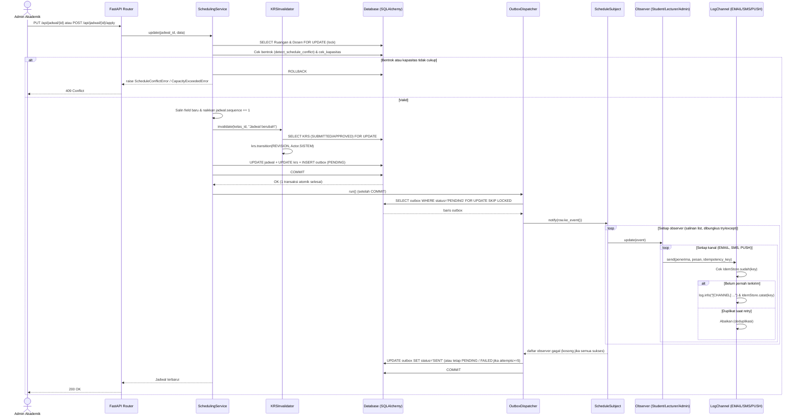
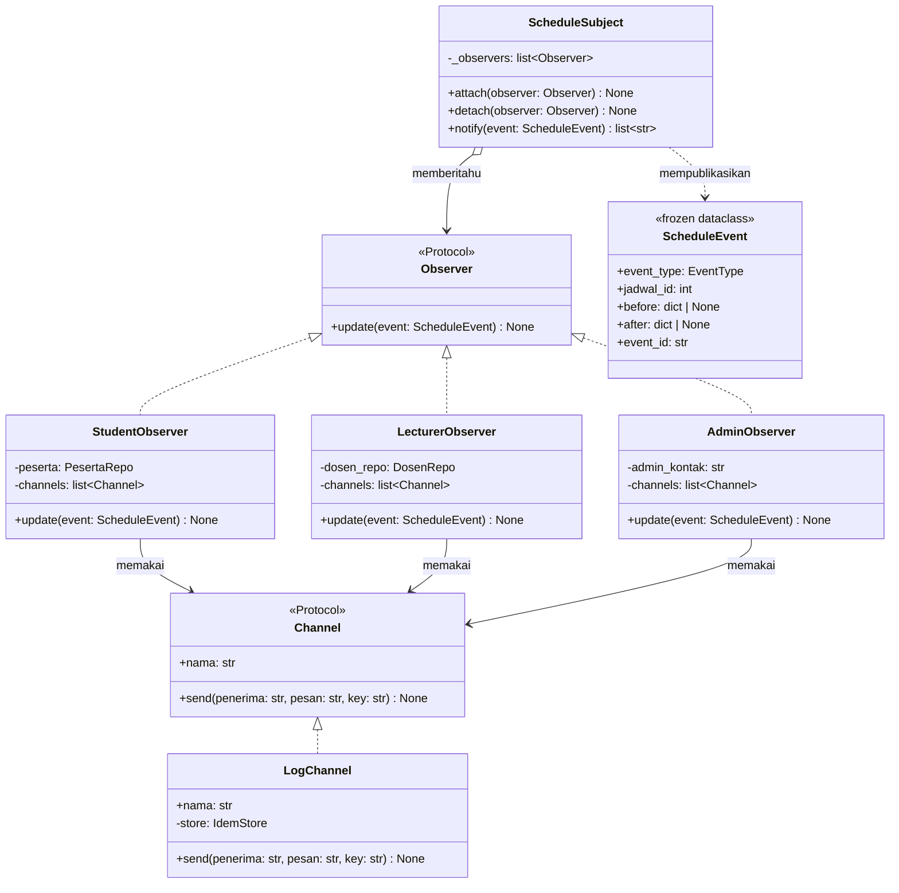

# UML Sequence Diagram & Class Diagram — Observer Pattern + Transactional Outbox

Dokumen ini memvisualisasikan alur eksekusi **aktual** pada codebase SEVIMA-Mini
([service.py](../app/scheduling/service.py),
[outbox.py](../app/scheduling/outbox.py),
[observer.py](../app/scheduling/observer.py), dan
[invalidator.py](../app/krs/invalidator.py)).

> **Poin Kritis Audit Arsitektur:** Perhatikan bahwa perintah `COMMIT` berada **di atas** (sebelum) `OutboxDispatcher` memanggil `ScheduleSubject.notify(event)`. Dengan demikian, notifikasi tidak pernah dikirim untuk perubahan jadwal yang gagal/di-rollback.

---

## 1. UML Sequence Diagram — Update Jadwal, Invalidasi KRS, Outbox, & Notifikasi

---

## 2. UML Class Diagram — Observer Pattern & Strategy Channel

